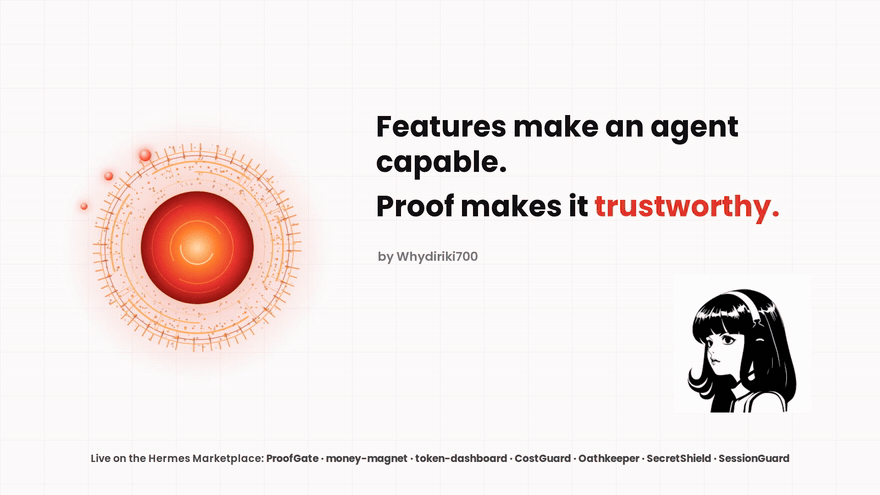

PYTHON · JAVASCRIPT · NODE.JS · SQLITE · TAURI

---

01&nbsp;&nbsp;ABOUT

## About

I am Riki Wahyudi.

I build agents that do real work, prove what they did, and stay inside their owner's rules.

I design and build AI agent systems and the automation around them: multi-agent platforms, agent tooling, and the checks that keep agent work verifiable.

Most of this work is open source and built in the open, one shipped piece at a time.

---

02&nbsp;&nbsp;PROOF OF WORK

## Proof of Work

Seven Hermes agent plugins, written for the Hermes hackathon and merged after review. Seven of seven catalog pull requests were accepted.

**ProofGate** blocks a done claim until checkable proof exists.

**money-magnet** a local money ledger with five tools. It tracks income, spending, and balances on your own machine, with no bank connection.

**token-dashboard** a live meter of token use and model cost on the Hermes desktop.

**CostGuard** stops the next tool work once the budget limit is crossed.

**Oathkeeper** turns an owner's written rules into machine-checked gates.

**SecretShield** blocks or redacts leaked API keys and tokens in tool calls and replies.

**SessionGuard** checkpoints work state as the agent goes, so an interrupted session resumes from evidence, not guesswork.

Pull Shark: earned on this account for merged pull requests.

**Marketplace:** [hermes-agent.nousresearch.com/marketplace](https://hermes-agent.nousresearch.com/marketplace)

The Trust Layer. Watch the full film on X: [x.com/rikiwahyudi8o/status/2119765541191872770](https://x.com/rikiwahyudi8o/status/2119765541191872770)

---

03&nbsp;&nbsp;FEATURED BUILDS

## Featured Builds

**[Yuki.ai](https://github.com/Whydiriki700/yuki-ai-showcase)** a managed AI chief of staff for founders and solopreneurs, with an enforced contract, a critic gate, and a public failure ledger.

**Osvyn** desktop app for running many agent profiles side by side, each with its own accounts, on a local agent bus.

**osvyn-mobile** Android companion for Osvyn. Free and open source under the MIT license, distributed through Telegram.

**portfolio** personal portfolio site for this account, deployed on Vercel.

Experiments, kept public as working notes: secret-scan, commit-keeper, context-keeper.

---

04&nbsp;&nbsp;CURRENT FOCUS

## Current Focus

Lexis Agent, a terminal-first AI agent, is in active development.

The Hermes plugin set is complete at seven. No further plugins are planned.

Osvyn is being hardened toward a public release.

---

05&nbsp;&nbsp;LINKS

## Links

**Hermes Marketplace:** [hermes-agent.nousresearch.com/marketplace](https://hermes-agent.nousresearch.com/marketplace)

**Osvyn on Telegram:** [t.me/osvynofficial](https://t.me/osvynofficial)

**X:** [@rikiwahyudi8o](https://x.com/rikiwahyudi8o)
